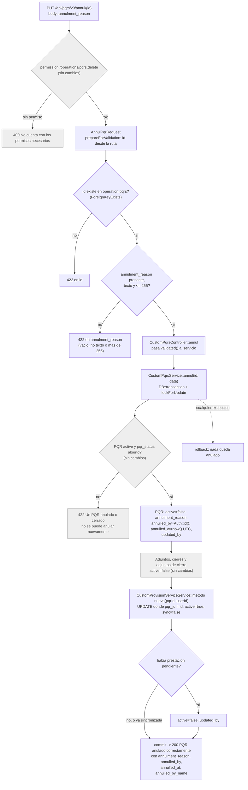

# AIO 11411 — Etapa 1: anular un PQR con motivo (backend)

## Diagrama

Lo gris es comportamiento que ya existe y no cambia.

## Decisiones

| Pieza | Decision |
|---|---|
| `annulment_reason` | `string` de 255, nulable. La HU dice varchar y el tope lo repite el Request |
| `annulled_by` | entero grande sin signo, nulable, FK a `users.id` con `restrict` |
| `annulled_at` | `timestamp`, nulable. Se guarda en UTC con `now()`, igual que `closed_at`; el front lo convierte |
| Datos viejos | Los PQR ya anulados quedan con las tres en nulo; el front muestra solo «PQR anulado» |
| RN-07 (no cambian despues) | Ya cubierto: el update usa `validated()` de `StorePqrsRequest`, que no declara estos campos. No se agrega nada |
| Sin prestacion | No es error: el UPDATE afecta cero filas |

## Plan de construccion

**Paso 1 — Migracion.**
- Comando: `./vendor/bin/sail artisan make:migration add_annulment_to_pqrs_table`. Crea el archivo con la fecha en el nombre, para que corra despues de las anteriores.
- Contenido: sobre `operation.pqrs`, las tres columnas nulables con su comentario en espanol; la FK de `annulled_by` hacia `users` con nombre propio y `restrict`. En `down()`, primero quitar la FK por su nombre y despues las tres columnas.
- Referencias: `2026_09_30_130000_add_identification_number_to_pqrs_table.php` (forma) y `2026_09_07_100000_add_pqr_id_to_provision_services_table.php:13-19, 30-37` (FK).
- Verificacion: `sail artisan migrate`, luego `sail artisan migrate:rollback --step=1` y otra vez `migrate`. Si el rollback falla, el `down()` no es el inverso.

**Paso 2 — Modelo `Pqrs`.**
- Contenido: las tres columnas en `$fillable`; `annulled_at` en `$casts` como fecha; relacion `annulledBy()` a `User` por `annulled_by` (copia `updater()`); accesor `getAnnulledByNameAttribute` (copia `getUpdaterNameAttribute`); `annulled_by_name` en `$appends`; `annulledBy:id,first_name,last_name` en `$with`; `annulledBy` en `$hidden`.
- Por que `$hidden`: sin eso la respuesta lleva el objeto del usuario completo ademas del nombre, igual que pasaria con `updater`.
- Verificacion: `sail artisan tinker` de solo lectura, cargar un PQR y ver que `annulled_by_name` sale en `toArray()` (nulo).

**Paso 3 — `AnnulPqrRequest` (nuevo).**
- Ruta: `app/Http/Requests/Modules/Operation/Pqrs/AnnulPqrRequest.php`.
- Contenido: copia de `CancelDispatchRequest`, cambiando la tabla a `operation.pqrs` con la etiqueta «PQR» y el campo a `annulment_reason`, con sus mensajes en espanol.
- Verificacion: queda para el paso 7.

**Paso 4 — Metodo nuevo en `CustomProvisionServiceService`.**
- Firma: recibe el id del PQR y el id del usuario; devuelve nada o la cantidad de filas.
- Contenido: un solo UPDATE sobre las prestaciones con ese `pqr_id`, `active = true` y `sync = false`, que pone `active = false` y `updated_by`. Sin transaccion propia.
- Docblock de 2 renglones con `@param` y `@return`.
- Va antes del servicio de PQR porque ese lo va a llamar.

**Paso 5 — `CustomPqrsService::annul`.**
- Firma: recibe el id y el arreglo validado (copia la forma de `cancelDispatch`).
- Contenido: inyectar `CustomProvisionServiceService` en el constructor; en el UPDATE del PQR (hoy linea 271) agregar el motivo, `annulled_by`, `annulled_at` y `updated_by`; despues de los cierres, llamar al metodo del paso 4 dentro de la misma transaccion. Actualizar el docblock.
- Cuidado: revisar si el constructor ya inyecta algo que dependa de `CustomPqrsService`, para no armar un ciclo.

**Paso 6 — `CustomPqrsController::annul`.**
- Contenido: la firma recibe `AnnulPqrRequest` en lugar de `Request` y pasa `$request->validated()` al servicio. En el `@OA` agregar el `RequestBody` con `annulment_reason` y la respuesta 422.
- Ojo: el metodo tiene `@OA`, asi que no lleva PHPDoc aparte.

**Paso 7 — `AnnulTest`.**
- Contenido: las pruebas que hoy anulan sin motivo pasan a mandarlo. Casos nuevos: sin motivo (422), con 256 caracteres (422), que guarda motivo, usuario y fecha, prestacion pendiente anulada, prestacion sincronizada intacta.
- Verificacion: `sail artisan test tests/Feature/Modules/Operation/Pqrs/AnnulTest.php`.
