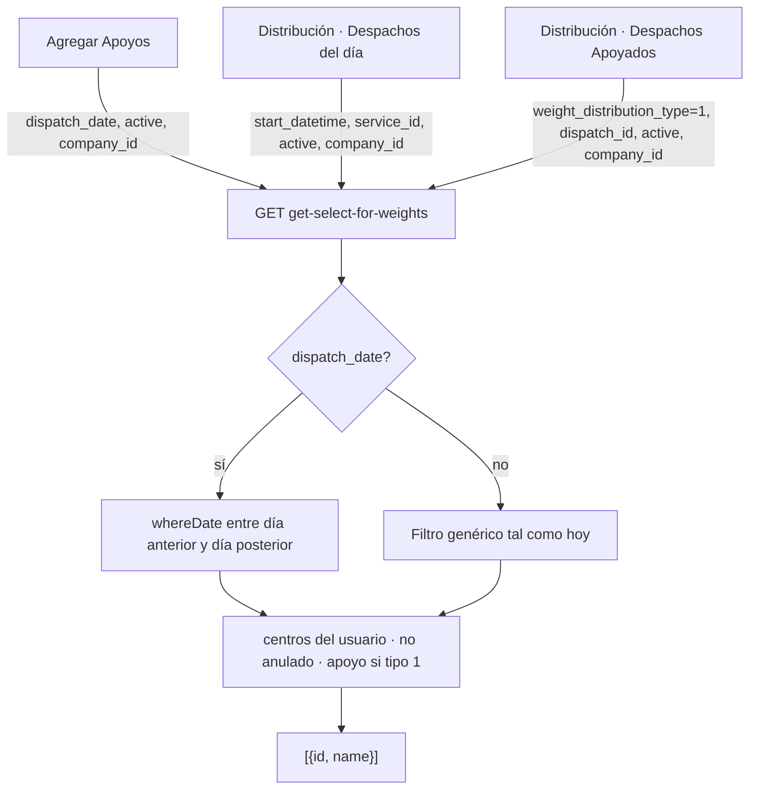

# 11927 — Plan de construcción (borrador de Fabian, corregido)

Selector de despachos de Apoyos y de «Despachos Apoyados» en la Distribución de pesos. Toca back y front.

## Decisiones

1. Apoyos: cualquier servicio y turno, todo menos Anulado, centros del usuario.
2. Rango de Apoyos: del día anterior al día posterior al despacho (Fabian, 2026-11-17; amplía la decisión
   anterior, que era día anterior y mismo día).
3. Sin llave nueva: se reutiliza `dispatch_date`, que hoy no envía ningún consumidor del endpoint
   (`grep` en aio-app y app-movil, 2026-11-17).
4. Distribución de pesos: «Despachos del día» igual; «Despachos Apoyados» sin filtro de fecha ni servicio.

## Flujo

## Reutilización

| Se reutiliza | No se implementa | Se escribe nuevo |
|---|---|---|
| Llave `dispatch_date` y su `isset`/`unset` en `getSelectForWeights` | Llave nueva en el contrato | Rango de fechas en el `->when($dispatchDate…)` |
| Filtro genérico `QuerysFilters`, `whereExists` del tipo 1, centros del usuario | Cambios en `DispatchService.ts`, en el Service/Controller estándar o en `QuerysFilters` | Prueba `SupportDispatchSelectTest.php` |
| Setup de `ClosedDispatchDistributionTest` como modelo de la prueba | | Sección en `closed-dispatch-weight-distribution.md` |

## Pasos

| # | Repo · archivo | Lugar | Qué hacer | Cómo se verifica |
|---|---|---|---|---|
| 1 | back · `CustomDispatchService.php` | `->when($dispatchDate…)` L1312 | Cambiar el `whereDate` de un día por dos `whereDate` (`>=` día anterior, `<=` día posterior). Calcular los días con Carbon: el archivo no lo importa | tinker con query log: el SQL trae los dos límites |
| 2 | back · mismo | Docblock L1276-1280 | Un renglón que diga qué devuelve y qué hace `dispatch_date`; `@param` y `@return` | Lectura |
| 3 | back · `CustomDispatchController.php` | `@OA` ~L436-451 | El example ya trae `dispatch_date`: agregar en la descripción del parámetro que es un rango de tres días | `sail artisan l5-swagger:generate` sin error |
| 4 | back · `tests/Feature/Modules/Operation/Dispatch/SupportDispatchSelectTest.php` (nuevo) | — | Taller guiado (clase de `laravel-pruebas`) | La prueba pasa, y falla si se devuelve el paso 1 |
| 5 | front · `DispatchRouteSupportForm.vue` | `filters` L157-162 | Quitar `service_id` **y cambiar `start_datetime` por `dispatch_date`** | Pantalla: Apoyos del despacho ofrece otros servicios y días vecinos |
| 6 | front · `WeightDistributionForm.vue` | `getDispatches()` L114-122 | `start_datetime` y `service_id` solo en «Despachos del día» | Pantalla: los dos tipos |
| 7 | back · `docs/modules/operation/closed-dispatch-weight-distribution.md` | — | Qué ofrece cada selector | Lectura |
| 8 | back | — | Regresión `ClosedDispatchDistributionTest.php` | Pasa |
