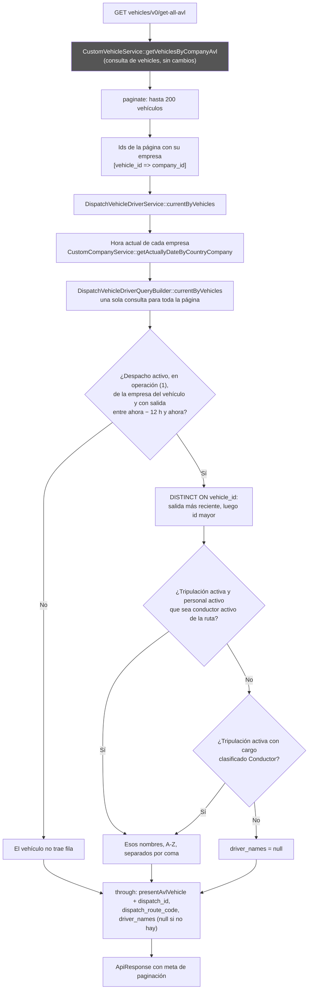

# 11934 · Parte A — El listado trae el despacho y el conductor

## Flujo

Lo gris no cambia. `selectAvlVehicle` y `presentAvlVehicle` no se tocan: los usa también el aviso en vivo.

## Pasos de construcción

| # | Archivo | Qué queda | Verificación |
|---|---|---|---|
| 1a | `app/Queries/Modules/Operations/Dispatch/DispatchVehicleDriverQueryBuilder.php` (nuevo) | Clase con docblock; método `currentByVehicles(array $vehicleIds, array $nowByCompany): Collection` que devuelve `vehicle_id`, `dispatch_id`, `dispatch_route_code`, sin conductores todavía | Tinker con los datos de prueba |
| 1b | Mismo archivo | Columna `driver_names`: ruta primero, cargo después | Tinker |
| 2 | `app/Services/Modules/Operation/Dispatch/DispatchVehicleDriverService.php` (nuevo) | Calcula la hora de cada empresa y llama al QueryBuilder; devuelve la colección por `vehicle_id` | Tinker |
| 3 | `CustomVehicleService` | Inyecta el servicio 2; `getVehiclesByCompanyAvl` pega los tres campos en el `through` | Pantalla / Postman con los datos de prueba |
| 4a | `tests/Feature/Modules/Settings/Vehicle/AvlIndexTest.php` (toca; no estaba en la solución de referencia) | `AVL_FIELDS` con los tres campos nuevos; el aviso en vivo se compara contra el listado sin esos tres | `sail artisan test` del archivo: 2 pasan |
| 4 | `tests/Feature/Modules/Settings/Vehicle/AvlDispatchDriverTest.php` (nuevo) | Casos CA-05 a CA-10, CA-14, RN-03 | `sail artisan test` del archivo |

Datos de prueba (cargados el 2026-11-23 ~08:15 hora Colombia, empresa 9): despachos 4721-4729.
Esperado de 1a con vehículos `[102,111,112,113,114,115,116,117]`: filas para 111 (4721), 112 (4722),
113 (4723), 114 (4724), 115 (4726, no 4725). Sin fila: 102, 116 (13 h), 117 (cerrado y futuro).

## Decisiones de Fabian (2026-11-23)

- Una empresa a la vez: el QueryBuilder recibe una sola fecha, `currentByVehicles(array $vehicleIds, string $companyNow)`, sin JSON.
- ~~Opción B (empresa activa por `company_id`)~~ — descartada el mismo día: limitaba el listado a la empresa activa y hoy Seguimiento GPS muestra la flota de todas las empresas del usuario.
- **Opción A (vigente)**: se mantiene la flota de todas las empresas. El front no envía `company_id`. En el paso 3, `getVehiclesByCompanyAvl` recorre `$unitsByCompany` (empresa => unidades) y por cada empresa llama a `currentByVehicles` con los vehículos de la página de esa empresa (por `business_unit_id`); junta las filas en un solo `$drivers`. QueryBuilder y servicio no cambian.
